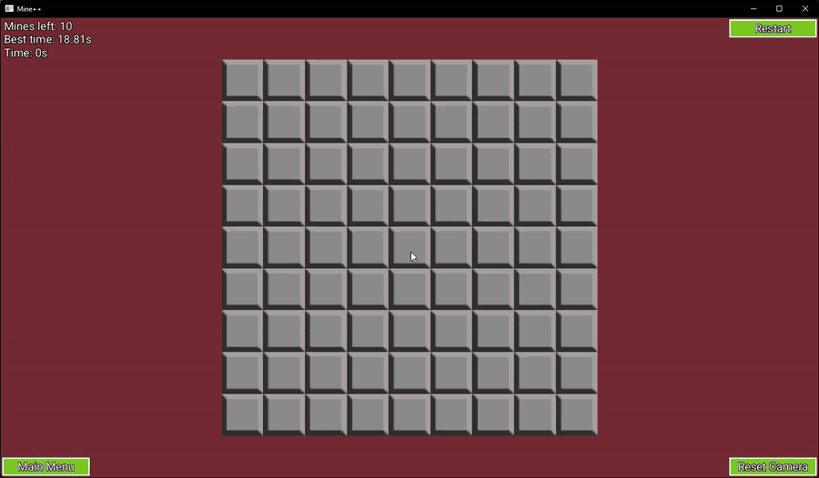
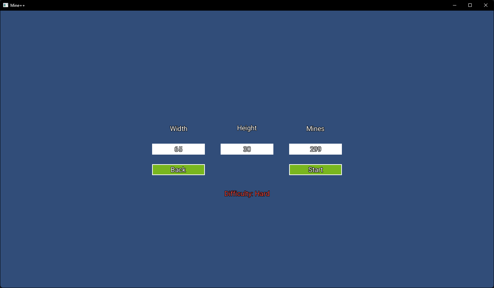
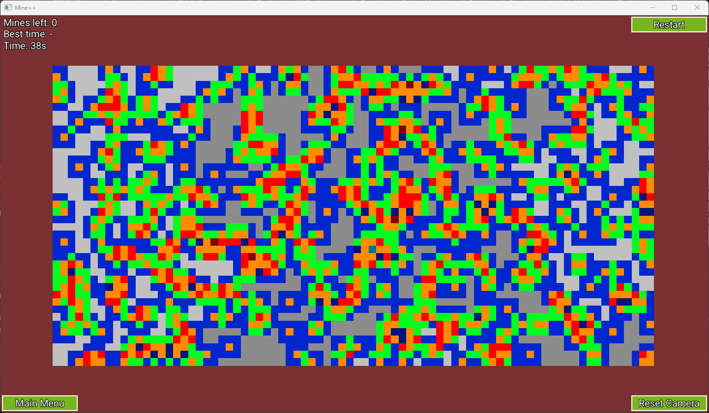
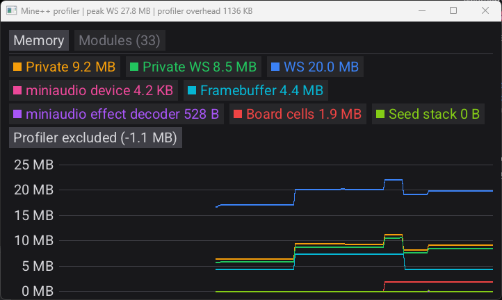

# Mine++

**Mine++** is a C++ remake of a Minesweeper I co-developed as my very first Unity game.
This remake is a personal challenge in memory optimization: using as little memory as possible at runtime, without sacrificing performance.

The main target is **Windows**. The code also builds on Linux (X11), but that platform is not actively supported.

🔗 [Original Unity version](https://github.com/lvocanson/Minesweeper)



---

## Contents

- [Download](#download)
- [How to play](#how-to-play)
  - [Main menu](#main-menu)
  - [Play menu](#play-menu)
  - [Custom board](#custom-board)
  - [In game](#in-game)
  - [Settings](#settings)
- [Save files](#save-files)
- [Technical overview](#technical-overview)
- [Development quickstart (Windows)](#development-quickstart-windows)
- [Build options](#build-options)
- [License](#license)

---

## Download

Get `MinePlusPlus.exe` from the [latest release](https://github.com/lvocanson/MinePlusPlus/releases/latest). No installation is needed: run the executable.

---

## How to play

Reveal every safe tile without opening a mine. Each revealed number tells how many mines touch that tile.

### Main menu

- **Play**: choose a game mode and a board.
- **Settings**: volume, camera sensitivity and resets.
- **Quit**: close the game.

### Play menu

Click the **game mode** button to cycle through the modes:

| Mode | Description |
|---|---|
| Default | Classic Minesweeper. |
| Spinning | The board slowly rotates on itself. |
| Running Bomb | Some mines move to another undiscovered tile at each revealing click. There is one per 40 mines, plus one (1 in Beginner, 2 in Intermediate, 3 in Expert). |

Then pick a board:

| Board | Size | Mines |
|---|---|---|
| Beginner | 9 × 9 | 10 |
| Intermediate | 16 × 16 | 40 |
| Expert | 30 × 16 | 99 |
| Custom | your choice | your choice |

### Custom board

Click a field to edit its value.
A message below the fields reports invalid values and an estimated difficulty.
**Start** launches the game if the values are valid.



### In game

| Input | Action |
|---|---|
| Left click on a hidden tile | Reveal it. The first click of a game is always safe. |
| Left click on a revealed number | Reveal its neighbours, if the number of adjacent flags matches the number. |
| Right click | Place or remove a flag. |
| Middle button drag | Move the camera. |
| Mouse wheel | Zoom in or out, centered on the cursor. |

During a game, the top-left corner shows the remaining mines, the best time for this board and the current time.
When the game ends, this text moves to the center of the screen and shows the result and the final time.

Buttons:
- **Restart**: start a new game on the same board.
- **Reset Camera**: center the board in the window.
- **Main Menu**: leave the game.

A best time is kept for each combination of mode, width, height and mine count.

### Settings

| Setting | Range | Meaning |
|---|---|---|
| Volume (%) | 0 – 100 | Master volume. |
| Pan sensitivity (%) | 10 – 1000 | 100 makes the board follow the cursor exactly; 50 moves it half as far. |
| Zoom sensitivity (%) | 10 – 1000 | Zoom speed of each wheel step. |

**Reset preferences** restores the default settings and forgets the last game mode and custom board.

**Reset scores** erases all best times.

---

## Save files

The game writes two small binary files:

| Platform | Folder |
|---|---|
| Windows | `%APPDATA%\Mine++\` |
| Linux | `$XDG_DATA_HOME/Mine++/`, or `~/.local/share/Mine++/` |

| File | Content |
|---|---|
| `preferences.bin` | Volume, pan and zoom sensitivity, last game mode, last custom board (width, height, mines). |
| `scores.bin` | Best time for each mode, width, height and mine count. |

Deleting a file resets its content, like the buttons in the settings.

---

## Technical overview

The Release build uses about **6.3 MiB of private memory** on Windows (main menu, 1440 × 810 window), of which the framebuffer alone takes 4.4 MiB.

- **No GPU.** In the earlier SFML version, the graphics driver was the largest memory consumer. Everything is now drawn by the CPU into a [MiniFB](https://github.com/emoon/minifb) framebuffer.
- **Board rendering.** Each screen pixel is mapped to its cell with fixed-point arithmetic, without any per-cell texture. When zoomed out, a one-pixel-per-cell atlas replaces the detailed one.

  
- **Baked assets.** At build time, `asset_baker` converts the cell atlases to 8-bit indexed images and rasterizes the Roboto font (20 px, ASCII) with [stb_truetype](https://github.com/nothings/stb). Every resource is embedded in the executable: nothing is loaded from disk, and stb is not linked into the game.
- **Audio.** Only the low-level device of [miniaudio](https://github.com/mackron/miniaudio) is used; its engine, node graph and resource manager are compiled out. Sounds are IMA ADPCM WAV files, decoded on the fly from the embedded data.
- **Windows specifics.** The input method editor is disabled (`ImmDisableIME`), and non-Debug builds link the C++ runtime statically while keeping the Universal CRT as a system DLL.
- **Saves.** Fixed-size raw records, validated on load.

Dependencies are downloaded by CMake (`FetchContent`) at pinned commits.

---

## Development quickstart (Windows)

Requirements: **Visual Studio 2022** or later with the **Desktop development with C++** workload (it includes CMake and Ninja), **Git**, and an internet connection for the first configuration (dependencies are downloaded by CMake).

1. Open a **Command Prompt** in a folder with a **short path** (the MSVC compiler does not support paths longer than 260 characters).
2. Run the following command:
   ```cmd
   git clone https://github.com/lvocanson/MinePlusPlus.git ./MinePlusPlus && start devenv ./MinePlusPlus
   ```
3. Visual Studio opens the folder and configures the project automatically, using the presets of `CMakePresets.json`.
   You can track the progress in the **Output Window**, under the **CMake** category.
4. Once configuration completes, select `MinePlusPlus.exe` as the startup item at the top of the screen (next to the green play button).

---

## Build options

Two CMake options, both `OFF` by default, add development tools to the game.
The `x64-debug-full` and `x64-release-full` presets enable both.

| Option | Key | Effect |
|---|---|---|
| `MPP_PROFILING` | F1 | Opens or closes the profiler window (Windows only). |
| `MPP_CHEATS` | F2 | Reveals every safe tile that has adjacent mines. |
| | F3 | Removes wrong flags and flags every mine. |

The profiler has two tabs:
- **Memory**: a graph of the private bytes, private working set and working set of the process, along with internal counters (framebuffer, board cells, audio decoders…). The profiler can exclude its own cost from the graph.
- **Modules**: every DLL loaded by the process, when it was loaded, its size and the call stack that loaded it.



A game in which a cheat was used does not record its time.

---

## License

Mine++ is released under the [MIT License](LICENSE).

Third-party components keep their own licenses:

| Component | License |
|---|---|
| [MiniFB](https://github.com/emoon/minifb) | MIT |
| [miniaudio](https://github.com/mackron/miniaudio) | Public domain or MIT No Attribution |
| [stb](https://github.com/nothings/stb) | Public domain or MIT |
| [Roboto](https://fonts.google.com/specimen/Roboto) font | [SIL Open Font License 1.1](res/roboto-OFL.txt) |
